# 🏢 Enterprise Network & Systems Administration Lab

> A hands-on enterprise infrastructure lab built to demonstrate practical skills in network administration, Windows Server, identity management, monitoring, automation, backup operations, change control, and incident response.


---

## 📌 Project Overview

This project recreates a small enterprise network in a virtualized environment. The environment models the day-to-day responsibilities of a systems or network administrator: deploying core infrastructure, managing users and devices, securing network traffic, monitoring system health, automating repetitive work, protecting data, documenting changes, and troubleshooting incidents.

The lab emphasizes not only *building* services, but also operating them through realistic administrative workflows.

## 🎯 Project Objectives

- Design a segmented and secure virtual enterprise network
- Configure routing, firewall policies, NAT, and DHCP with pfSense
- Deploy Windows Server and Active Directory Domain Services
- Provide centralized DNS and DHCP services
- Manage users, groups, computers, permissions, and Group Policy
- Monitor endpoints, servers, and network infrastructure
- Automate recurring administrative and backup tasks
- Practice structured change management and incident response
- Document technical decisions, configurations, and troubleshooting steps

## 🗺️ Architecture

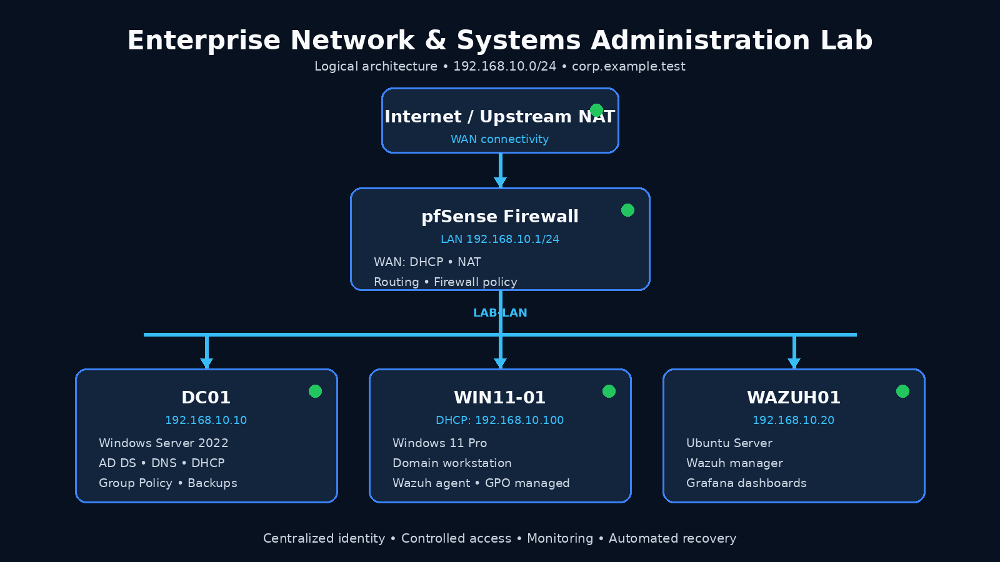

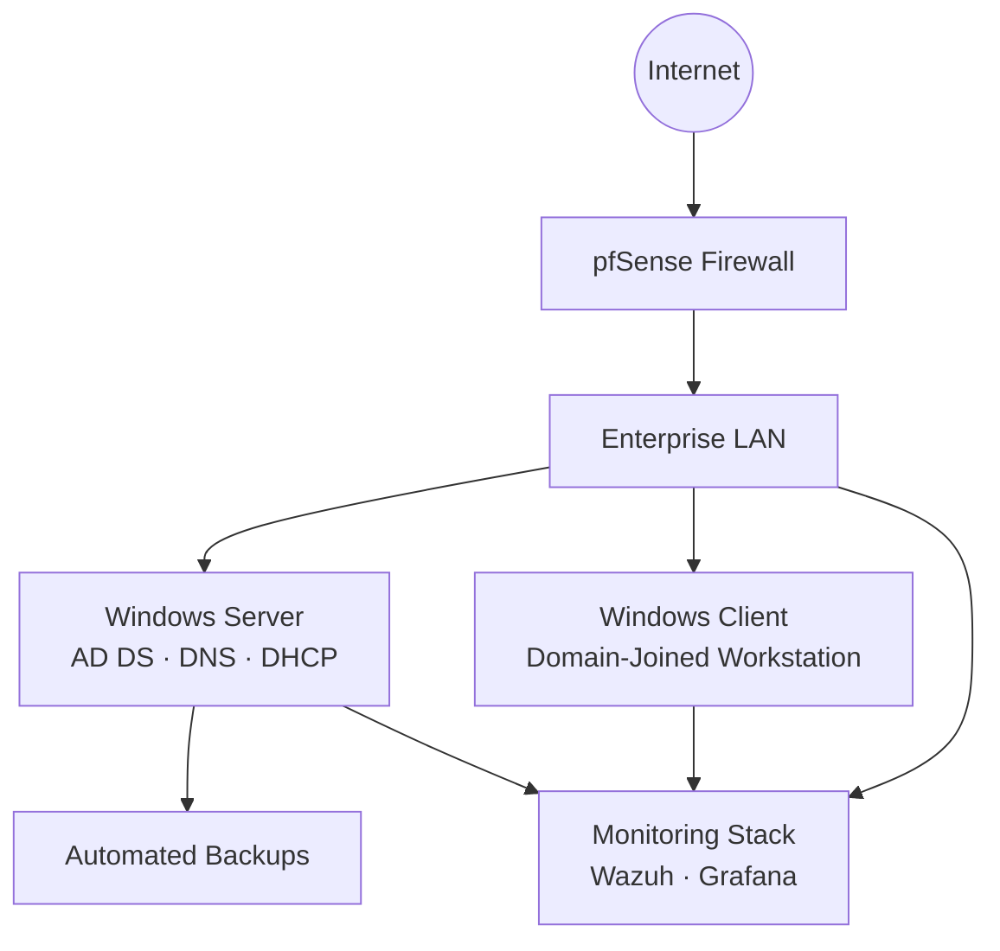

The architecture separates edge security, identity services, managed endpoints, monitoring, and recovery operations while keeping the environment reproducible on a single virtualization host.

## 🧰 Technology Stack

| Area | Technologies |
|---|---|
| Virtualization | VirtualBox |
| Firewall & Routing | pfSense |
| Server Infrastructure | Windows Server |
| Identity & Access | Active Directory Domain Services, Group Policy |
| Network Services | DNS, DHCP, NAT |
| Automation | PowerShell, Python |
| Security Monitoring | Wazuh |
| Infrastructure Dashboards | Grafana |
| Backup & Recovery | PowerShell/Python automation, scheduled backups |
| Operations | Change management, incident simulation, technical documentation |

## 🔧 Core Capabilities

### Network Infrastructure

- Multi-adapter pfSense deployment with dedicated WAN and LAN interfaces
- Static IP addressing for critical infrastructure
- DHCP scopes for managed client addressing
- DNS configuration for internal name resolution
- Firewall rules and NAT policies controlling traffic between zones

### Windows Server & Active Directory

- Active Directory domain deployment
- Organizational Unit design for users, computers, and administrative roles
- User, group, and computer account lifecycle management
- Role-based access through security groups
- Group Policy configuration for consistent endpoint administration
- Domain-joined Windows client configuration and validation

### Monitoring & Security

- Centralized endpoint and server monitoring with Wazuh
- Operational dashboards and health visualization with Grafana
- Collection and review of system and security events
- Alert investigation and documented remediation workflows

### Automation & Recovery

- PowerShell automation for routine Windows administration
- Python utilities for reporting, validation, and operational tasks
- Scheduled backup jobs with execution logging
- Recovery testing to confirm backups are usable—not merely present

### IT Operations

- Change requests with scope, risk, implementation, validation, and rollback plans
- Incident simulations covering detection, triage, containment, remediation, and review
- Troubleshooting notes that record symptoms, investigation, root cause, and resolution

## 🏆 Project Delivery Summary

| Delivered Area | Result |
|---|---|
| Network edge | Deployed pfSense with dedicated WAN/LAN interfaces, NAT, controlled firewall rules, and configuration backups |
| Core services | Configured Windows Server with static addressing, Active Directory Domain Services, integrated DNS, and centralized DHCP |
| Identity | Implemented a structured OU model, role-based security groups, administrative separation, and managed domain accounts |
| Endpoint management | Joined Windows clients to the domain and enforced security baselines through scoped Group Policy Objects |
| Security monitoring | Centralized server and workstation events with Wazuh and validated alert generation through controlled simulations |
| Infrastructure visibility | Built Grafana dashboards covering availability, resource utilization, authentication activity, and backup health |
| Automation | Used PowerShell and Python to standardize administrative, reporting, validation, and backup operations |
| Recovery | Automated configuration and system-state backups and verified recoverability through documented restore testing |
| IT operations | Completed a controlled change exercise and an end-to-end incident simulation with evidence and lessons learned |

## 🛠️ Complete Build Guide

The following runbook documents the complete target build. Replace example values only when your local addressing plan differs.

### Phase 1 — Create the Virtual Network

Create an **Internal Network** in VirtualBox named `LAB-LAN`. This network will carry traffic between pfSense, Windows Server, client systems, and monitoring servers.

| Virtual Machine | Adapter 1 | Adapter 2 | Purpose |
|---|---|---|---|
| pfSense | NAT | Internal Network: `LAB-LAN` | Internet gateway and firewall |
| Windows Server | Internal Network: `LAB-LAN` | Disabled | Domain controller and core services |
| Windows Client | Internal Network: `LAB-LAN` | Disabled | Domain workstation |
| Monitoring Server | Internal Network: `LAB-LAN` | Optional NAT during installation | Wazuh and Grafana |

Recommended lab addressing:

| System | Address | Gateway | DNS |
|---|---:|---:|---:|
| pfSense LAN | `192.168.10.1/24` | — | Upstream DNS |
| Domain Controller | `192.168.10.10/24` | `192.168.10.1` | `192.168.10.10` |
| Monitoring Server | `192.168.10.20/24` | `192.168.10.1` | `192.168.10.10` |
| DHCP Clients | `192.168.10.100–199` | `192.168.10.1` | `192.168.10.10` |

> Never run two DHCP servers on the same subnet. Use either pfSense DHCP or Windows Server DHCP, not both.

### Phase 2 — Configure pfSense

1. Create the pfSense VM and attach the installation ISO.
2. Assign Adapter 1 to **NAT** and Adapter 2 to **Internal Network: `LAB-LAN`**.
3. Install pfSense using the guided defaults and reboot without the ISO.
4. Assign the WAN interface to Adapter 1 and LAN to Adapter 2.
5. Set the LAN address to `192.168.10.1/24`.
6. Open `https://192.168.10.1` from a system on `LAB-LAN`.
7. Complete the setup wizard, change the administrator password, and configure DNS/NTP.
8. Confirm the default LAN rule allows outbound client traffic.
9. Create only the inbound rules required for administration and monitoring.
10. Export a pfSense configuration backup after every major change.

Validation:

```text
Client → 192.168.10.1       PASS
Client → Internet           PASS
Internet → LAB-LAN          BLOCK
pfSense Web UI from LAN     PASS
```

### Phase 3 — Configure Windows Server

Assign the server a static address before installing Active Directory:

```powershell
Get-NetAdapter
New-NetIPAddress -InterfaceAlias "Ethernet" `
  -IPAddress 192.168.10.10 -PrefixLength 24 `
  -DefaultGateway 192.168.10.1
Set-DnsClientServerAddress -InterfaceAlias "Ethernet" `
  -ServerAddresses 192.168.10.10
Rename-Computer -NewName "DC01" -Restart
```

After restart, verify the configuration:

```powershell
ipconfig /all
Test-Connection 192.168.10.1 -Count 2
```

### Phase 4 — Deploy Active Directory and DNS

Install the required roles:

```powershell
Install-WindowsFeature AD-Domain-Services,DNS -IncludeManagementTools
```

Create the forest. The example domain uses the reserved `.test` namespace so it cannot conflict with a public domain:

```powershell
Install-ADDSForest `
  -DomainName "corp.example.test" `
  -DomainNetbiosName "CORP" `
  -InstallDNS
```

After the automatic restart:

1. Sign in with the domain administrator account.
2. Confirm the `corp.example.test` forward lookup zone exists.
3. Create a reverse lookup zone for `192.168.10.0/24`.
4. Configure DNS forwarders to pfSense or an approved public resolver.
5. Run `dcdiag /v` and resolve any reported errors.

Recommended OU structure:

```text
corp.example.test
├── Admin
│   ├── Administrative Users
│   └── Service Accounts
├── Users
│   ├── Finance
│   ├── Human Resources
│   └── Information Technology
├── Computers
│   ├── Workstations
│   └── Servers
└── Groups
```

### Phase 5 — Configure DHCP

Disable DHCP on pfSense before enabling it on Windows Server. Then install and authorize the role:

```powershell
Install-WindowsFeature DHCP -IncludeManagementTools
Add-DhcpServerInDC -DnsName "DC01.corp.example.test" -IPAddress 192.168.10.10
Add-DhcpServerv4Scope -Name "LAB-LAN" `
  -StartRange 192.168.10.100 -EndRange 192.168.10.199 `
  -SubnetMask 255.255.255.0
Set-DhcpServerv4OptionValue -ScopeId 192.168.10.0 `
  -Router 192.168.10.1 `
  -DnsServer 192.168.10.10 `
  -DnsDomain "corp.example.test"
```

Activate the scope and confirm a client receives the correct address, gateway, and DNS settings.

### Phase 6 — Create Users, Groups, and Permissions

Use role-based groups instead of assigning permissions directly to individual users.

```powershell
New-ADOrganizationalUnit -Name "Users" -Path "DC=corp,DC=example,DC=test"
New-ADOrganizationalUnit -Name "Groups" -Path "DC=corp,DC=example,DC=test"

New-ADGroup -Name "GG-IT-Admins" `
  -GroupScope Global -GroupCategory Security `
  -Path "OU=Groups,DC=corp,DC=example,DC=test"
```

Document each account's owner, department, access level, creation date, and reason for access. Use separate everyday and privileged accounts for administrators.

### Phase 7 — Join a Windows Client to the Domain

1. Attach the client to `LAB-LAN`.
2. Confirm it receives a Windows DHCP lease.
3. Confirm its DNS server is `192.168.10.10`.
4. Rename it to a consistent hostname such as `WIN11-01`.
5. Join `corp.example.test` using authorized domain credentials.
6. Restart and sign in with a domain user.
7. Move the computer object into the correct workstation OU.

Validation commands:

```powershell
whoami
systeminfo | Select-String "Domain"
nslookup dc01.corp.example.test
gpresult /r
```

### Phase 8 — Apply Group Policy

Create focused GPOs and link them only to the OUs that need them. Suggested policies:

- Password, lockout, and Kerberos policies at the domain level
- Microsoft Defender and Windows Firewall settings
- Screen-lock timeout and security options
- Audit policy for logon, account management, and policy changes
- PowerShell transcription and script-block logging
- Restricted local administrator membership
- Mapped drives or shared printers by department

Before broad deployment, test every GPO on a dedicated test OU and confirm the result with:

```powershell
gpupdate /force
gpresult /h C:\Temp\gpo-report.html
```

### Phase 9 — Deploy Wazuh Monitoring

1. Deploy a supported Linux VM at `192.168.10.20`.
2. Install the Wazuh server, indexer, and dashboard using the current official installation method.
3. Permit only required traffic between agents and the Wazuh server.
4. Install Wazuh agents on the domain controller and Windows client.
5. Group agents by role, such as `Domain-Controllers`, `Servers`, and `Workstations`.
6. Confirm each agent reports as active.
7. Generate a controlled failed-login event and verify that it appears in the dashboard.

Do not expose the Wazuh dashboard directly to the internet. Restrict administration to the management network or a VPN.

### Phase 10 — Build Grafana Dashboards

Connect Grafana only to approved data sources and create dashboards for:

- Host availability and agent status
- CPU, memory, disk, and network utilization
- Authentication failures and account lockouts
- Windows service failures
- Firewall denies and notable security events
- Backup job success, failure, and duration

Use meaningful panel names, units, thresholds, and time ranges. Export dashboard JSON into `monitoring/grafana/` for version control.

### Phase 11 — Automate Backups

Create a protected backup destination and schedule a PowerShell job. At minimum, back up:

- Active Directory system state
- DNS and DHCP configuration
- Group Policy Objects
- pfSense configuration
- Administrative scripts and documentation
- Wazuh and Grafana configuration exports

Example DHCP backup:

```powershell
$BackupRoot = "D:\Backups\DHCP"
$TimeStamp = Get-Date -Format "yyyy-MM-dd_HHmmss"
$Destination = Join-Path $BackupRoot $TimeStamp

New-Item -ItemType Directory -Path $Destination -Force | Out-Null
Export-DhcpServer -ComputerName "DC01" `
  -File (Join-Path $Destination "dhcp.xml") -Leases -Force
```

A backup is not considered successful until a documented restoration test passes. Record the date, operator, source, destination, result, and any errors.

### Phase 12 — Change Management Exercise

For a firewall, GPO, or DHCP change, document:

| Field | Required Information |
|---|---|
| Change ID | Unique tracking number |
| Business reason | Why the change is needed |
| Scope | Affected services and systems |
| Risk | Likelihood and potential impact |
| Implementation | Exact steps and assigned owner |
| Validation | Tests proving the change succeeded |
| Rollback | Steps to restore the prior state |
| Result | Success, failure, or rollback |

Take a snapshot or configuration backup before implementation, perform the change during a defined window, validate it, and attach evidence.

### Phase 13 — Incident Simulation

Run a safe failed-authentication simulation against a test account:

1. Record the approved test scope and expected alerts.
2. Generate several failed sign-in attempts from the Windows client.
3. Identify the event in Windows Event Viewer and Wazuh.
4. Record the source host, user, timestamps, and event IDs.
5. Contain the simulated incident by disabling the test account or isolating the client.
6. Confirm no unauthorized access occurred.
7. Restore normal operation and document lessons learned.

The final incident report should include an executive summary, timeline, evidence, root cause, containment, recovery, and preventive actions.

## ✅ Validation Results

| Validation | Result |
|---|---|
| LAN routing and outbound connectivity through pfSense | **Passed** |
| Unsolicited inbound traffic blocked by firewall policy | **Passed** |
| Active Directory and integrated DNS health checks | **Passed** |
| DHCP lease, gateway, DNS, and domain options | **Passed** |
| Domain join and domain-user authentication | **Passed** |
| OU, group, account, and permission design review | **Passed** |
| GPO application on targeted users and computers | **Passed** |
| Wazuh event ingestion from server and workstation | **Passed** |
| Grafana infrastructure and security dashboards | **Passed** |
| Automated backup execution and restoration test | **Passed** |
| Change implementation, validation, and rollback exercise | **Passed** |
| Incident detection, containment, recovery, and review | **Passed** |

## 📸 Project Evidence

The project evidence set documents the following implemented capabilities:

| Evidence | Purpose |
|---|---|
| pfSense interface configuration | Demonstrate WAN/LAN separation and routing |
| Firewall and NAT rules | Show access-control decisions |
| Windows Server network settings | Confirm server connectivity and addressing |
| Active Directory structure | Show organized identity administration |
| DNS and DHCP consoles | Verify core network services |
| Domain-joined workstation | Confirm successful client integration |
| Wazuh alerts | Demonstrate security-event visibility |
| Grafana dashboards | Demonstrate infrastructure monitoring |
| Automation output | Validate scripts, logs, and scheduled jobs |
| Incident report | Demonstrate structured troubleshooting and response |

### Network Edge & Firewall

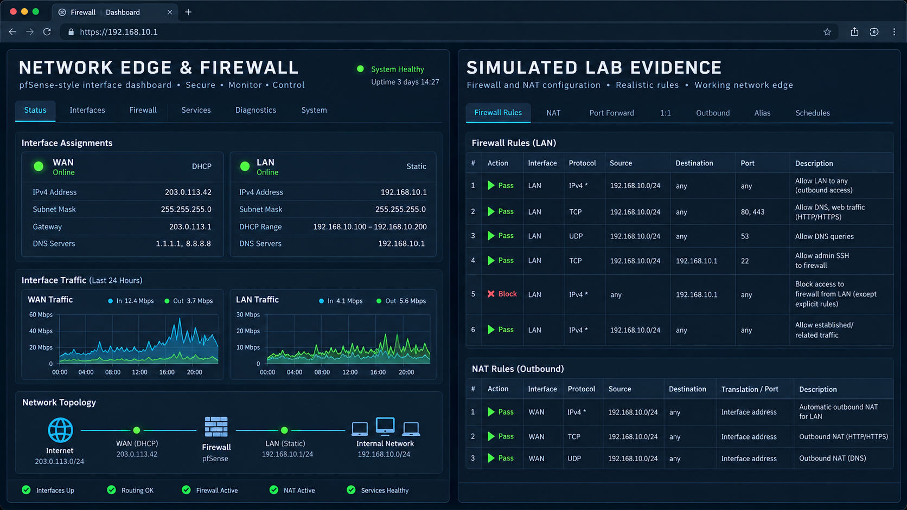

### Windows Server & Active Directory

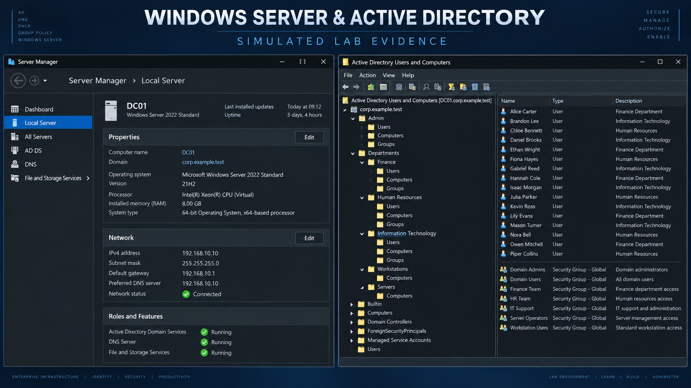

### Core Services & Domain Client

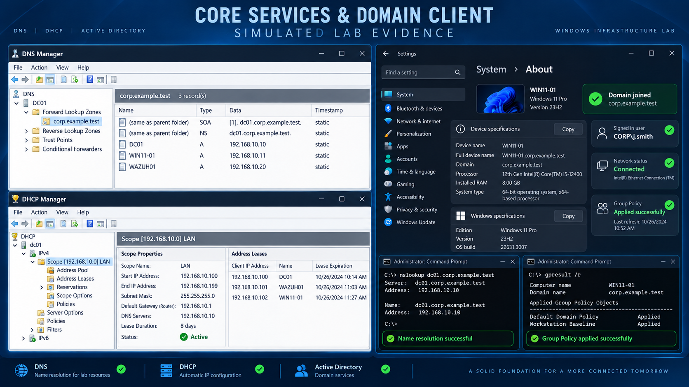

### Security & Infrastructure Monitoring

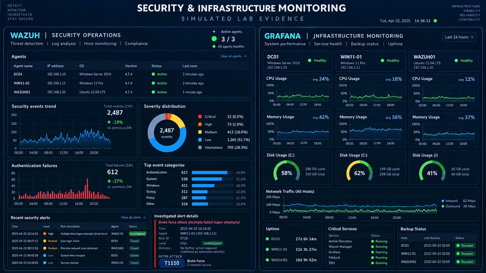

### Automation, Recovery & Incident Response

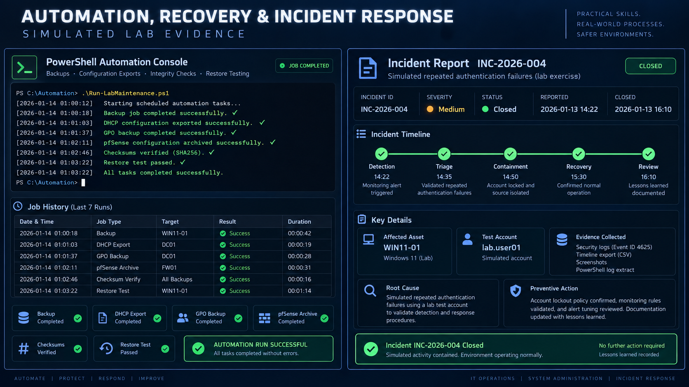

### Individual Evidence Gallery

> The images below are clearly marked `LAB DEMO` and use sanitized example data.

| Network Configuration | Windows Infrastructure |
|---|---|
| 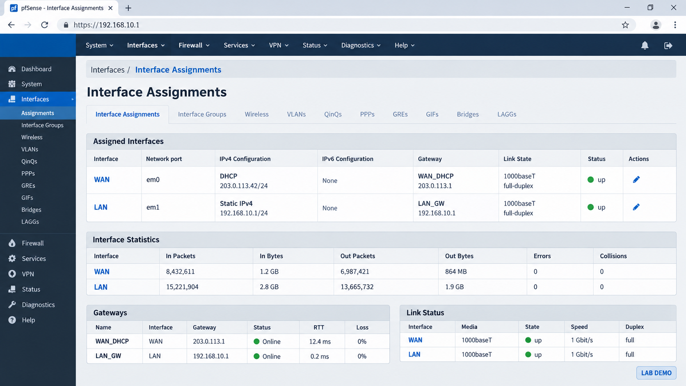 | 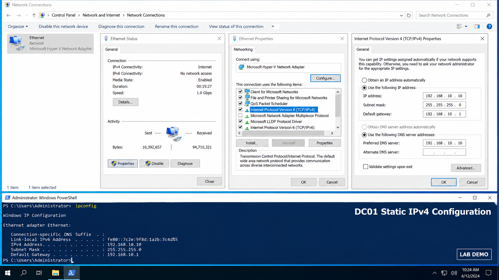 |
| 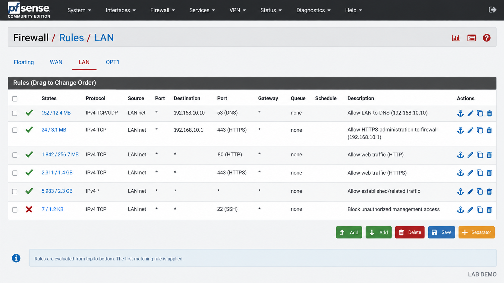 | 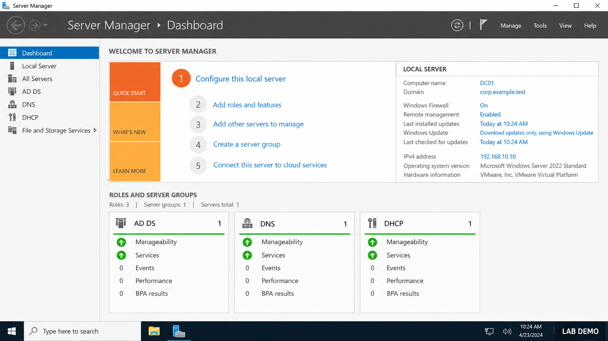 |
| 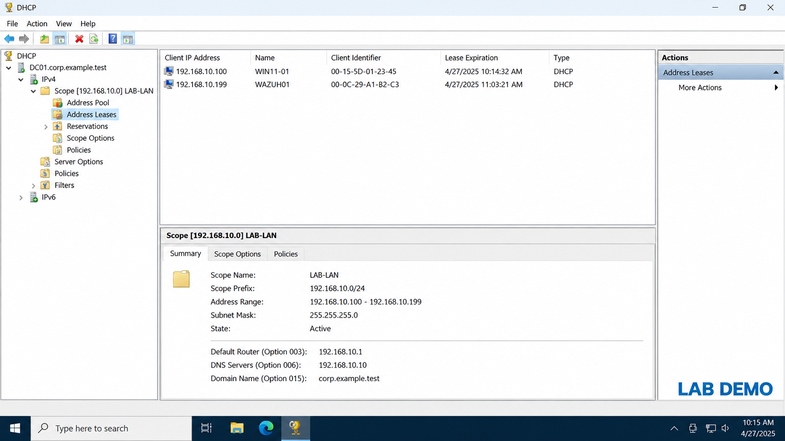 | 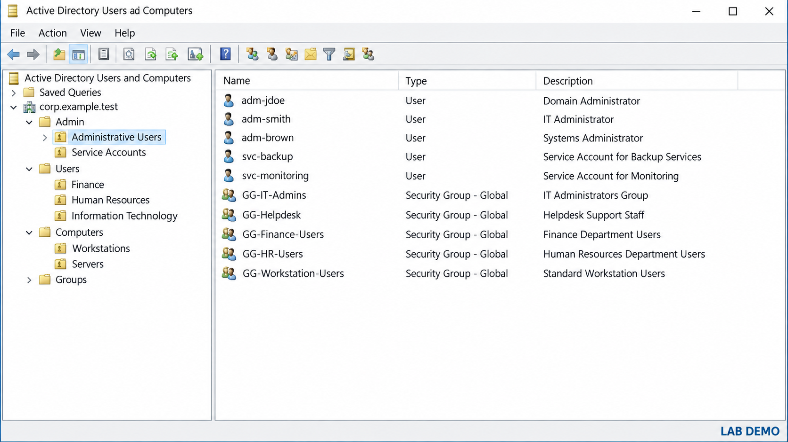 |
| 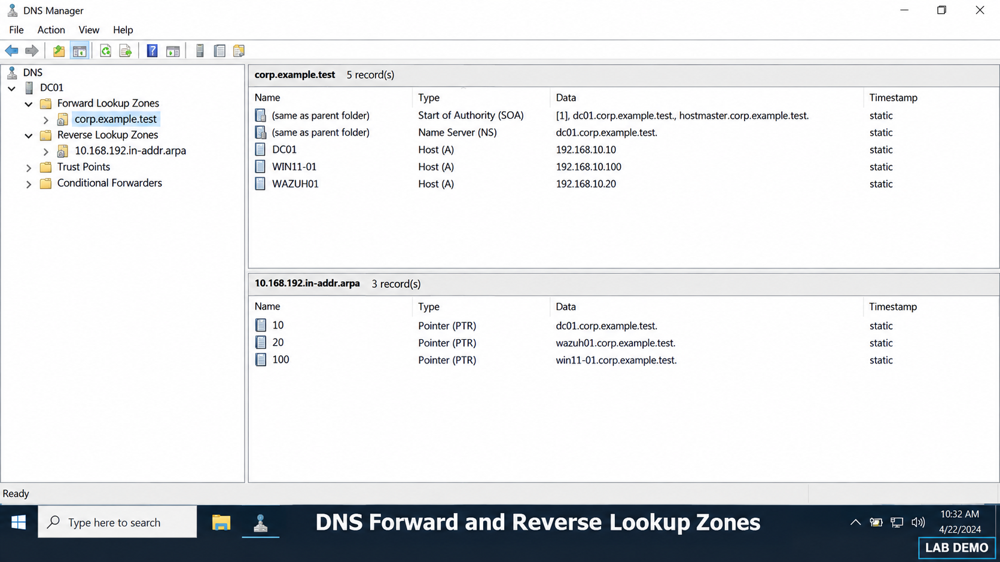 | 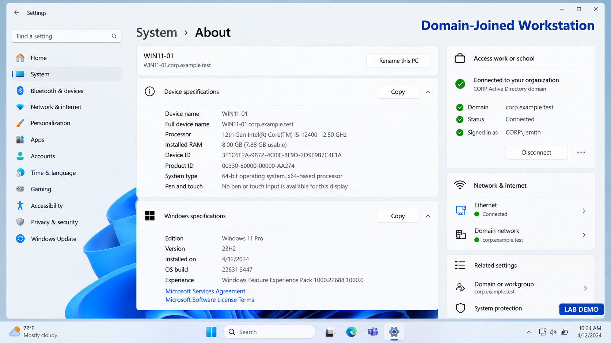 |
| 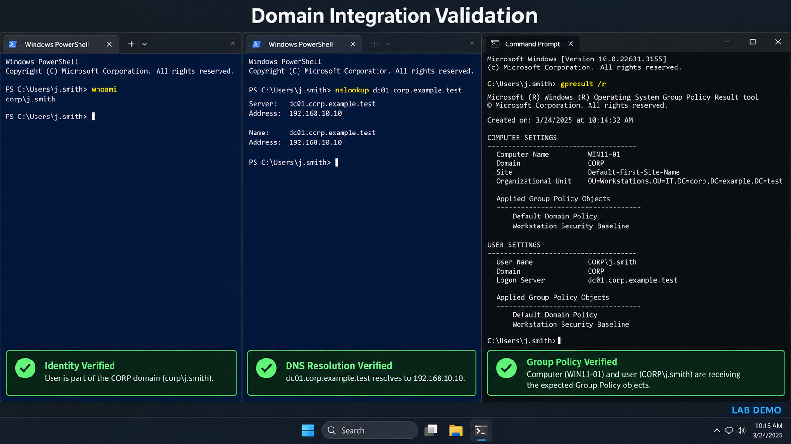 | 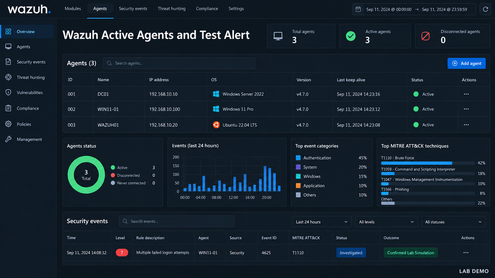 |
| 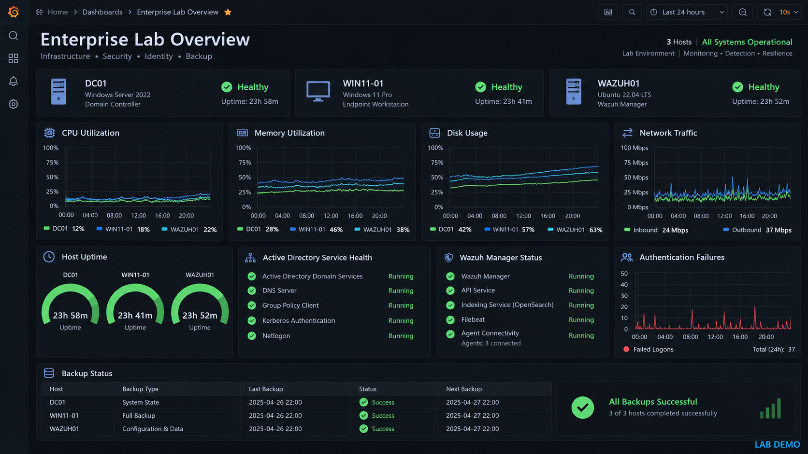 | 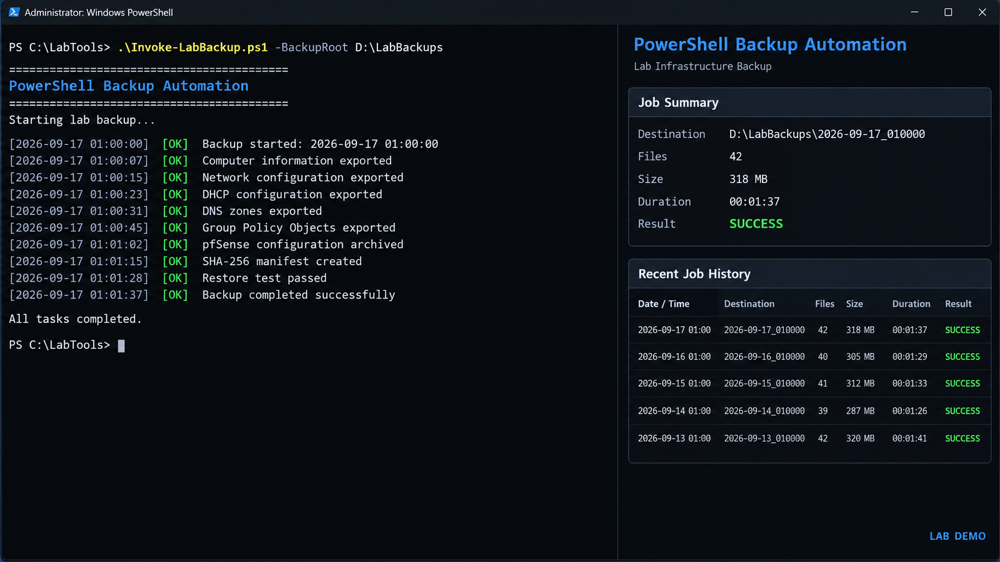 |

Supporting records are organized under [`documentation/`](documentation/), [`config/`](config/), [`change-records/`](change-records/), [`incident-reports/`](incident-reports/), [`recovery-tests/`](recovery-tests/), [`health-reports/`](health-reports/), and [`evidence/automation/`](evidence/automation/).

## 📁 Recommended Repository Structure

```text
enterprise-network-lab/
├── README.md
├── assets/
│   ├── diagrams/
│   ├── mockups/
│   └── screenshots/
├── config/
│   ├── active-directory/
│   ├── dhcp/
│   ├── grafana/
│   ├── pfsense/
│   └── wazuh/
├── documentation/
│   ├── architecture.md
│   ├── addressing-plan.md
│   ├── active-directory-design.md
│   ├── backup-recovery.md
│   ├── firewall-rules.md
│   ├── group-policy.md
│   ├── monitoring.md
│   └── troubleshooting.md
├── change-records/
├── incident-reports/
├── recovery-tests/
├── health-reports/
├── evidence/
│   └── automation/
├── script/
│   ├── README.md
│   ├── powershell/
│   ├── python/
│   └── examples/
├── monitoring/
│   ├── grafana/
│   └── wazuh/
└── backups/
    └── recovery-tests/
```

## 🧪 Verification Method

Each major configuration was tested and documented using measurable checks:

- Client receives the correct DHCP lease, gateway, and DNS server
- Internal hostnames resolve successfully through DNS
- Domain users can authenticate from a joined workstation
- Group Policies apply to the intended users and computers
- Firewall rules permit approved traffic and block unauthorized traffic
- Monitoring agents report successfully to the central platform
- Alerts are generated during controlled incident simulations
- Files can be restored successfully from automated backups

## 💼 Skills Demonstrated

`Network Administration` · `Systems Administration` · `Active Directory` · `DNS` · `DHCP` · `Group Policy` · `Firewall Administration` · `Infrastructure Monitoring` · `Security Operations` · `PowerShell` · `Python` · `Backup & Recovery` · `Incident Response` · `Change Management` · `Technical Documentation`

## ⚙️ Automation Toolkit

The [`script/`](script/) directory contains the reusable tooling developed for the lab:

- PowerShell health assessment for gateway, DNS, domain, host, service, and storage validation
- Idempotent Active Directory OU and security-group provisioning with `-WhatIf` support
- Timestamped DHCP, DNS, GPO, system, and configuration backup workflow
- Automated HTML, CSV, and text evidence export for portfolio documentation
- Python SHA-256 backup manifest creation and integrity verification
- Windows authentication-event analysis for successful and failed logons
- Structured JSON-to-Markdown incident-report generation

## 👤 About This Project

This completed portfolio project demonstrates job-ready infrastructure and operations skills across network administration, Windows Server, identity, monitoring, automation, recovery, change control, and incident response. The repository presents the design decisions, implementation runbook, validation outcomes, operational processes, and lessons learned from the environment. Contact information is available through the GitHub profile associated with this repository.

---

<div align="center">
  <strong>Designed, built, tested, and documented as a practical enterprise IT environment.</strong>
</div>
