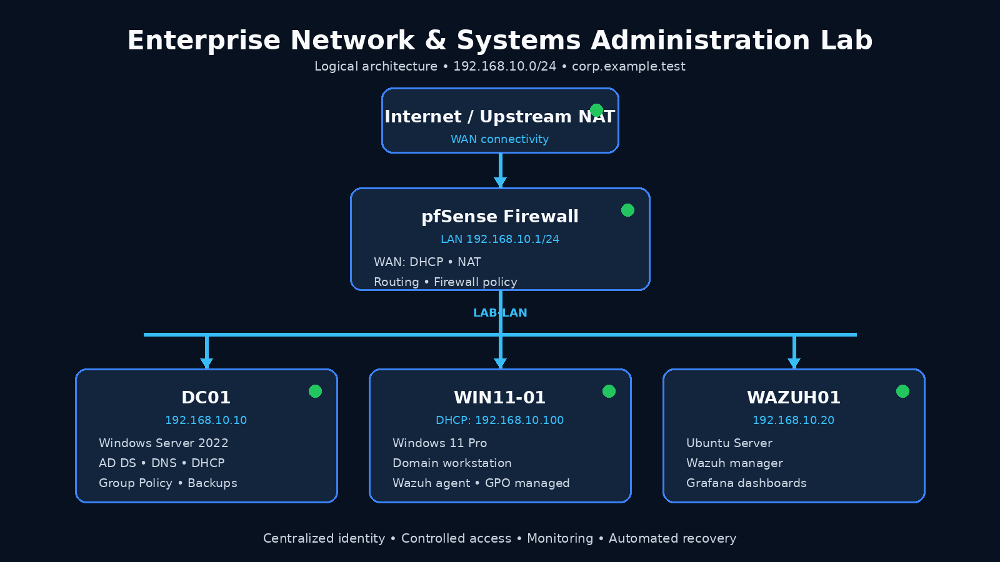

# Architecture

## Overview

The lab models a small enterprise environment on VirtualBox. pfSense forms the network edge, Windows Server provides identity and core network services, Windows 11 represents a managed endpoint, and an Ubuntu server provides security monitoring and dashboards.

## Components

| Component | Address | Responsibility |
|---|---:|---|
| pfSense | `192.168.10.1/24` | WAN/LAN routing, NAT, firewall policy |
| DC01 | `192.168.10.10/24` | AD DS, DNS, DHCP, Group Policy, backups |
| WAZUH01 | `192.168.10.20/24` | Wazuh manager, event indexing, Grafana |
| WIN11-01 | DHCP | Domain workstation and monitored endpoint |

## Trust boundaries

- WAN traffic terminates at pfSense.
- The `LAB-LAN` internal network uses `192.168.10.0/24`.
- Administrative interfaces are reachable only from the LAN.
- Clients use DC01 for DNS and pfSense as the default gateway.
- Monitoring agents send security telemetry to WAZUH01.

## Design decisions

- Static addresses are assigned to infrastructure services.
- DHCP client addresses occupy `192.168.10.100–199`.
- Internal DNS uses the reserved domain `corp.example.test`.
- Role-based groups separate permissions from individual user accounts.
- Backups include configuration exports and SHA-256 integrity manifests.

